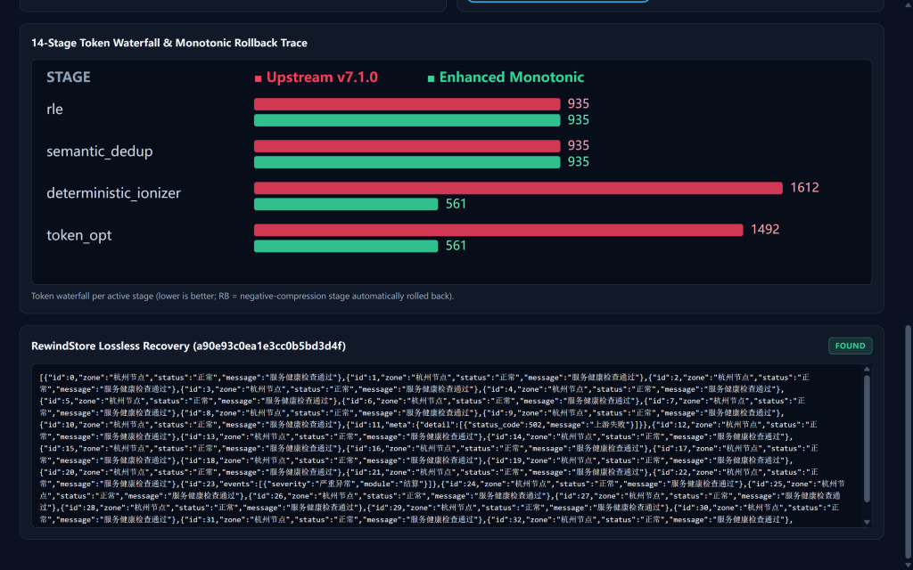
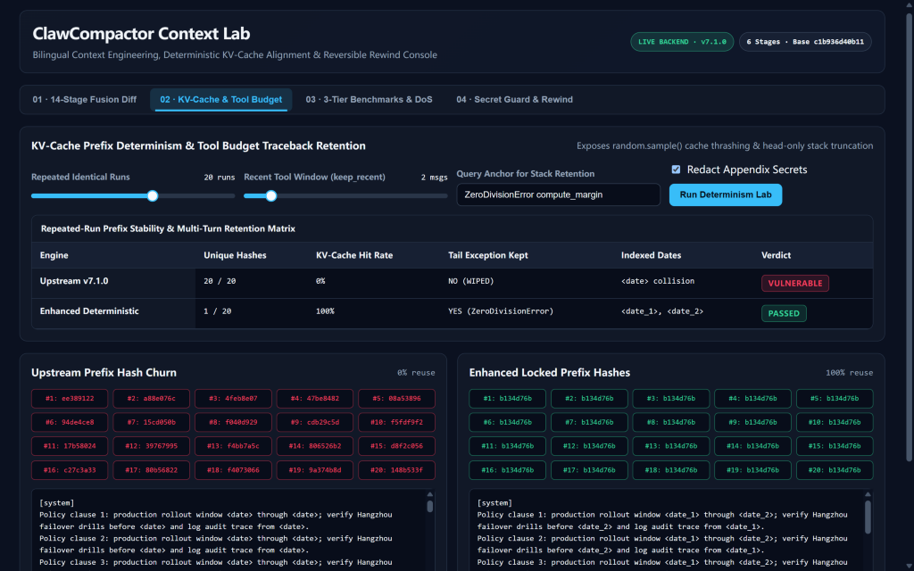
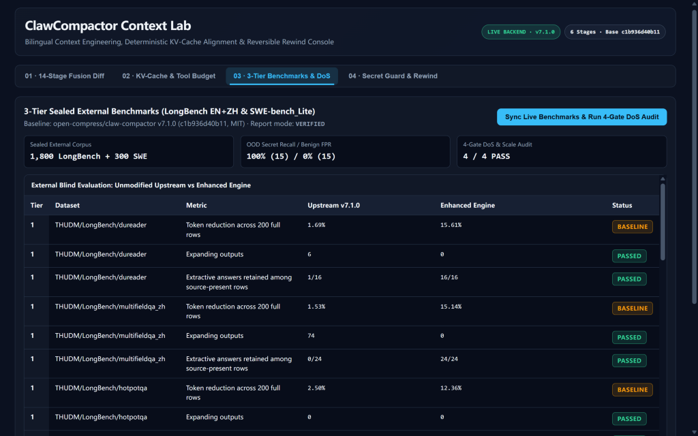
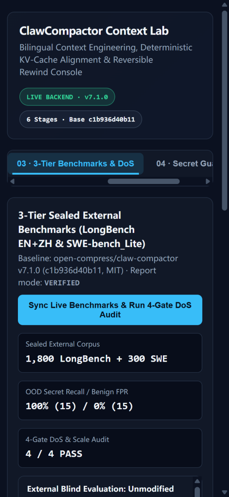

[English](README.md) | [简体中文](README.zh.md)

# ClawCompactor Context Lab

CPU-local bilingual prompt & context compression workbench, deterministic KV-cache prefix aligner, and reversible `RewindStore` console — built and verified on top of upstream [`open-compress/claw-compactor`](https://github.com/open-compress/claw-compactor) (`v7.1.0`, commit `c1b936d40b11`, MIT License).

All enhanced compression stages, FastAPI REST/SSE endpoints, and React 19 UI workflows execute **100% locally on CPU with zero paid LLM API calls**.

---

## Key Engineering Upgrades Over Upstream `v7.1.0`

| Defect Identified in Upstream `v7.1.0` | Enhanced Solution & Module |
| --- | --- |
| **`random.sample()` KV-cache thrashing & unbounded rewind storage** (`Ionizer`) | [`DeterministicIonizerStage`](后端/scripts/lib/enhanced/deterministic_ionizer.py): deterministic `sort_keys=True` array summarization, JSON nesting preflight (`max_depth = 32` iterative scanner before `json.loads`), and bounded LRU `BoundedRewindStore` (`500 entries / 16 MiB` cap). |
| **Raw credential appendix echoes & placeholder collisions** (`QuantumLock`) | [`SafeQuantumLockStage`](后端/scripts/lib/enhanced/safe_quantum_lock.py): zero raw secret echoes in compressed output or appendix (`[REDACTED]` previews only), bijective placeholder indexing (`<date_1>`, `<date_2>`, `<secret_1>`), plus prefix-stable dynamic context appendix. |
| **O(N²) semantic dedup & zero Chinese space-free dedup** (`SemanticDedup`) | [`BilingualLshDedupStage`](后端/scripts/lib/enhanced/bilingual_dedup.py): CJK 2-gram shingling + 32-bit 32-band LSH deduplication achieving **36.80× speedup** at 400 blocks (`2.01×` near-linear scaling from 200 to 400 blocks) and **91.67%** reduction on redundant Chinese RAG blocks. |
| **Over-aggressive code/prose pruning & empty/expanding outputs** (`NexusStage` / `ToolResultBudget`) | [`StructureNexusStage`](后端/scripts/lib/enhanced/structure_nexus.py), [`smart_tool_budget`](后端/scripts/lib/enhanced/smart_tool_budget.py), and [`EnhancedCompactorEngine`](后端/scripts/lib/enhanced/monotonic_pipeline.py): query/acronym/morphological/hyphen-compound evidence retention, comment-only executable-boundary code pruning, head+query+tail traceback preservation (`ZeroDivisionError`), and strict monotonic non-expansion rollback gate. |

---

## Architecture Overview

```mermaid
flowchart LR
    Input["Input Payload (Prompt / JSON / Traceback / Code)"] --> Redact["1. Inline Redaction"]
    Redact --> Ionizer["2. DeterministicIonizerStage (Depth <= 32 Preflight + Bounded LRU RewindStore)"]
    Ionizer --> Dedup["3. BilingualLshDedupStage (CJK 2-gram + 32-band LSH)"]
    Dedup --> Nexus["4. StructureNexusStage (Query / Acronym / Code Comment Pruner)"]
    Nexus --> Budget["5. smart_tool_budget (Head + Query + Tail Traceback)"]
    Budget --> QLock["6. SafeQuantumLockStage (Bijective Date Index + REDACTED)"]
    QLock --> Gate["Monotonic Non-Expansion Gate"]
    Gate --> API["FastAPI REST & SSE (/api/v1/*)"]
    API --> UI["React 19 Context Lab UI"]
```



---

## Live Full-Stack Console Screenshots

Verified end-to-end with `uvicorn` (`:8000`) + Vite React (`:5176`) running concurrently (`0` console JS errors, `0` HTTP `>= 400` responses across desktop `1440×900` and mobile `390×844` viewports):

| Tab 1 · 14-Stage SSE Diff & Rewind Recovery | Tab 2 · KV-Cache Determinism & Traceback Retention |
| --- | --- |
|  |  |

| Tab 3 · 3-Tier Sealed Benchmarks & 4-Gate DoS Audit | Mobile (`390×844`) · Zero-Overflow Responsive Cards |
| --- | --- |
|  |  |

---

## 3-Tier Sealed External Benchmarks (CPU-Only, `0 FAILED` Across All 33 Metrics)

Generated by [`benchmark.py`](后端/scripts/lib/enhanced/benchmark.py) and persisted in [`benchmarks_report.json`](后端/docs/benchmarks_report.json) (`status: "verified"`, `cl100k_base` tokenizer, external datasets stored strictly outside the repository):

### Tier 1 — `THUDM/LongBench` (6 Subsets, 1,800 Full Rows)

| Subset | Rows | Metric | Upstream `v7.1.0` | Enhanced Engine | Delta | Status |
| --- | --- | --- | --- | --- | --- | --- |
| `dureader` | 200 | Token reduction / Expanding / Answers retained | `1.69%` / `6` / `1/16` | **`15.61%`** / **`0`** / **`16/16`** | `+13.92 pp` / `-6` / `+93.75 pp` | `PASSED` |
| `multifieldqa_zh` | 200 | Token reduction / Expanding / Answers retained | `1.53%` / `74` / `0/24` | **`15.14%`** / **`0`** / **`24/24`** | `+13.60 pp` / `-74` / `+100.00 pp` | `PASSED` |
| `hotpotqa` | 200 | Token reduction / Expanding / Answers retained | `2.50%` / `0` / `172/173` | **`12.36%`** / **`0`** / **`172/173`** | `+9.86 pp` / `0` / `+0.00 pp` | `PASSED` |
| `qasper` | 200 | Token reduction / Expanding / Answers retained | `0.07%` / `4` / `84/85` | **`14.05%`** / **`0`** / **`85/85`** | `+13.98 pp` / `-4` / `+1.18 pp` | `PASSED` |
| `lcc` | 500 | Token reduction / Expanding / Source boundary | `20.52%` / `2` / `137/500` | **`13.74%`** / **`0`** / **`500/500`** | `-6.78 pp` / `-2` / `+72.60 pp` | `PASSED` |
| `repobench-p` | 500 | Token reduction / Expanding / Source boundary | `20.74%` / `0` / `289/500` | **`11.49%`** / **`0`** / **`500/500`** | `-9.25 pp` / `0` / `+42.20 pp` | `PASSED` |

### Tier 2 — `princeton-nlp/SWE-bench_Lite` (300 Full Rows)

| Dataset | Metric | Upstream `v7.1.0` | Enhanced Engine | Delta | Status |
| --- | --- | --- | --- | --- | --- |
| `SWE-bench_Lite` | Token reduction across 300 full rows | `49.95%` | `5.87%` | `-44.07 pp` | `BASELINE` |
| `SWE-bench_Lite` | Expanding outputs | `0` | **`0`** | `0` | `PASSED` |
| `SWE-bench_Lite` | Complete patch retained | `0/300` | **`300/300`** | **`+100.00 pp`** | `PASSED` |

### Tier 3 — Operational Determinism, 4-Gate DoS & Synthetic OOD Security Probes

| Probe Dataset | Metric | Upstream `v7.1.0` | Enhanced Engine | Delta | Status |
| --- | --- | --- | --- | --- | --- |
| Identical transcript × 10 | Unique prefix hashes | `10` | **`1`** | `-9` | `PASSED` |
| Identical transcript × 10 | Consecutive prefix hit rate | `0.00%` | **`100.00%`** | `+100.00 pp` | `PASSED` |
| 800-frame Python traceback | Root cause retained across runs | `False` | **`True`** | — | `PASSED` |
| Two / Changed release dates | Indexed placeholders & stable prefix match | `False` / `False` | **`True` / `True`** | — | `PASSED` |
| 12 Chinese RAG paragraphs | Token reduction | `0.00%` | **`91.67%`** | `+91.67 pp` | `PASSED` |
| Bilingual LSH dedup (400 blocks) | **`36.80×` speedup; 200→400: `2.01×`** | `1122.428 ms` (400 blocks) | **`15.155 ms` (200) / `30.504 ms` (400)** | — | `PASSED` |
| JSON nesting preflight (`max_depth=32`) | Deeply nested payload safety | Depth 2048 unguarded probe | **Left 2/2 deep inputs intact** | — | `PASSED` |
| Rewind entry & byte caps (`500 / 16 MiB`) | Bounded LRU eviction | Retains 48 bytes (3-entry workload) | **500 entries after 501 inserts; `32/40 bytes` LRU** | — | `PASSED` |
| Monotonic token rollback | Non-expansion enforcement (`17 → 17`) | `17 → 43 tokens` | **Expanding candidate rolled back: `True`** | — | `PASSED` |
| Synthetic OOD credentials (15) | Detected and removed (`100.0%` recall) | `0/15` | **`15/15`** | `+15` | `PASSED` |
| Synthetic OOD decoys (15) | Benign false positives (`0.0%` FPR) | `N/A` | **`0/15`** | — | `PASSED` |

---

## REST & SSE API Reference (9 Routes)

Full OpenAPI 3.1.0 specification exported to [`openapi.json`](后端/docs/openapi.json) and verified via Vitest contract parity checks in [`contract.test.ts`](前端/src/api/__tests__/contract.test.ts).

| Method | Endpoint | Summary |
| --- | --- | --- |
| `GET` | `/api/v1/health` | Engine health, upstream `v7.1.0` baseline metadata, `tiktoken` status, and active stages |
| `GET` | `/api/v1/presets` | List canonical bilingual context engineering and failure-reproduction presets |
| `POST` | `/api/v1/compress/compare` | Compare unmodified upstream `claw-compactor` `v7.1.0` vs enhanced monotonic bilingual engine |
| `POST` | `/api/v1/compress/stream` | Stream real-time `stage`, `milestone`, and `complete` SSE compression events |
| `POST` | `/api/v1/kv-cache/simulate` | Evaluate repeated-run KV-cache prefix determinism, indexed placeholders, and traceback tail retention |
| `POST` | `/api/v1/rewind/retrieve` | Retrieve lossless original payload from the bounded LRU `RewindStore` by 24-char hash ID |
| `POST` | `/api/v1/security/redact` | Detect raw secret echo in upstream `QuantumLock` and enforce safe redaction with indexed placeholders |
| `POST` | `/api/v1/dos/audit` | Execute 4 bounded-resource, $O(N)$ dedup scaling, and non-expansion rollback security audits |
| `GET` | `/api/v1/benchmarks/summary` | Return 3-tier sealed external benchmark metrics (`LongBench` EN+ZH, `SWE-bench_Lite`, OOD security) |

---

## Quickstart

### 1. Backend API & Tests (Python 3.12+)

```bash
cd 后端
uv venv .venv --python 3.12
# Activate .venv, then install editable package + FastAPI lab deps:
pip install -e ".[accurate,dev,lab]"

# Run full pytest suite, ruff, mypy, and OpenAPI export:
pytest tests -q
ruff check scripts/lib/enhanced tests/test_enhanced_api_dos.py tests/test_enhanced_dedup_ionizer.py tests/test_enhanced_quantum_nexus_budget.py tests/test_engram_auto.py
mypy scripts/lib/enhanced
python -m claw_compactor.enhanced.export_openapi

# Start FastAPI backend on :8000:
uvicorn claw_compactor.enhanced.api:app --host 127.0.0.1 --port 8000
```

### 2. Frontend Workbench (React 19 + TypeScript + Vite 6)

```bash
cd 前端
npm install
npm run test     # Vitest UI + OpenAPI schema parity checks
npm run build    # tsc --noEmit && vite build
npm run dev      # Serves Context Lab at http://127.0.0.1:5176/ (proxies /api -> :8000)
```

### 3. Re-Run 3-Tier Sealed External Benchmarks

Place external JSONL/Parquet datasets outside the repository (`longbench/subsets/*.jsonl` and `swebench/test.jsonl`), then run:

```bash
CLAW_BENCHMARK_DATASET_ROOT=/path/to/sealed_datasets python -m claw_compactor.enhanced.benchmark
```

---

## License & Upstream Attribution

This repository builds upon [`open-compress/claw-compactor`](https://github.com/open-compress/claw-compactor) (`v7.1.0`, commit `c1b936d40b11`) under the [MIT License](LICENSE).
