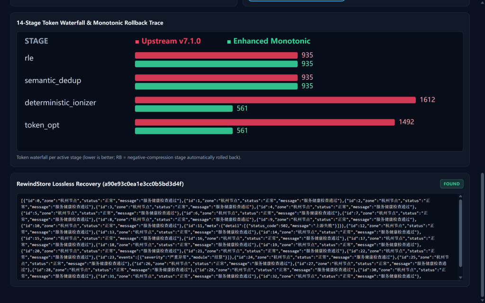
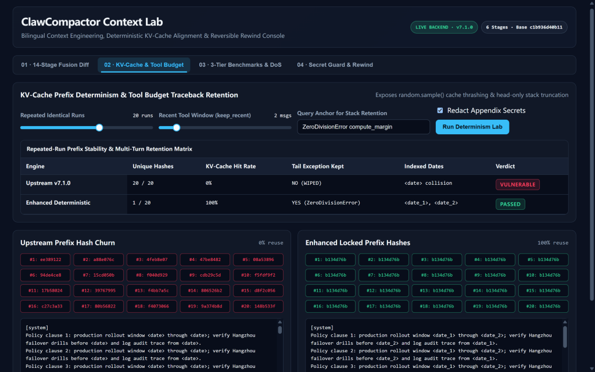
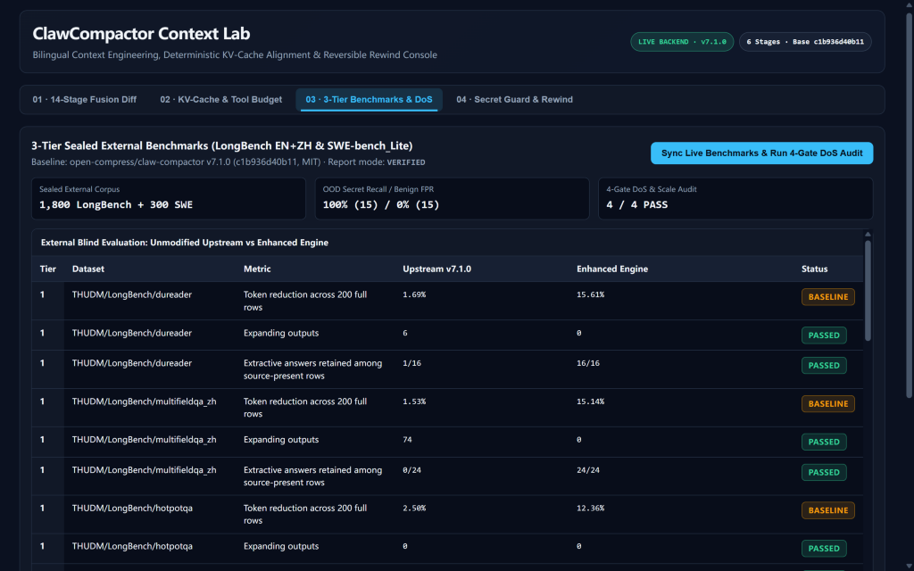
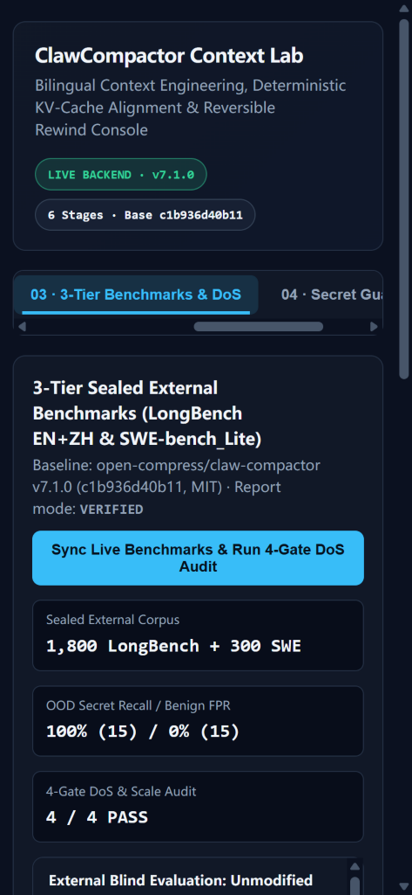

[English](README.md) | [简体中文](README.zh.md)

# ClawCompactor Context Lab（双语上下文压缩与 KV-Cache 确定性工作台）

面向 LLM Agent 生产工程的纯 CPU 本地化双语上下文压缩、KV-Cache 前缀确定性对齐与可逆 `RewindStore` 实验台。本项目基于上游开源仓库 [`open-compress/claw-compactor`](https://github.com/open-compress/claw-compactor)（`v7.1.0`，commit `c1b936d40b11`，MIT 协议）进行深度底层优化与全栈复现。

全部增强压缩阶段、FastAPI REST/SSE 后端接口与 React 19 控制台均**纯 CPU 本地运行，零付费 LLM API 调用开销**。

---

## 相比上游 `v7.1.0` 的核心工程升级

| 上游 `v7.1.0` 暴露缺陷 | 本项目增强方案与源码模块 |
| --- | --- |
| **`random.sample()` 导致 KV-Cache 失效与无界存储泄露** (`Ionizer`) | [`DeterministicIonizerStage`](后端/scripts/lib/enhanced/deterministic_ionizer.py)：确定性 `sort_keys=True` 数组摘要、进入 `json.loads` 前执行最大深度 `32` 的迭代预检、并落地受控 LRU 容量上限的 `BoundedRewindStore`（`500 entries / 16 MiB`）。 |
| **凭据明文附录回显与占位符碰撞** (`QuantumLock`) | [`SafeQuantumLockStage`](后端/scripts/lib/enhanced/safe_quantum_lock.py)：彻底杜绝凭据原文回显（仅输出 `[REDACTED]` 脱敏预览）、采用双射索引占位符（`<date_1>`、`<date_2>`、`<secret_1>`），并在尾部保留可追溯上下文附录。 |
| **O(N²) 语义去重瓶颈与中文无空格漏删** (`SemanticDedup`) | [`BilingualLshDedupStage`](后端/scripts/lib/enhanced/bilingual_dedup.py)：引入中英双字 2-gram Shingling + 32-bit 32-band LSH 去重，400 文本块加速 **`36.80×`**（200→400 块倍率仅 `2.01×` 近线性扩展），冗余中文 RAG 去重减容 **`91.67%`**。 |
| **代码/长文过裁剪丢边界与结果膨胀失控** (`NexusStage` / `ToolResultBudget`) | [`StructureNexusStage`](后端/scripts/lib/enhanced/structure_nexus.py)、[`smart_tool_budget`](后端/scripts/lib/enhanced/smart_tool_budget.py) 与 [`EnhancedCompactorEngine`](后端/scripts/lib/enhanced/monotonic_pipeline.py)：结合查询词形还原、混合大小写技术缩写（如 `(WSJ)`、`(DURel)`、`(ScRNN)`）与连字符复合词保留证据，支持仅剥离前导注释的代码压缩，并在门禁中强制单调非膨胀自动回滚与堆栈异常尾部保留（`ZeroDivisionError`）。 |

---

## 系统架构图

```mermaid
flowchart LR
    Input["输入载荷 (Prompt / JSON / Traceback / Code)"] --> Redact["1. Inline Redaction 内联脱敏"]
    Redact --> Ionizer["2. DeterministicIonizerStage (Depth <= 32 预检 + LRU RewindStore)"]
    Ionizer --> Dedup["3. BilingualLshDedupStage (CJK 2-gram + 32-band LSH)"]
    Dedup --> Nexus["4. StructureNexusStage (查询证据与代码注释裁剪)"]
    Nexus --> Budget["5. smart_tool_budget (首部+查询+尾部异常保留)"]
    Budget --> QLock["6. SafeQuantumLockStage (双射日期索引 + REDACTED)"]
    QLock --> Gate["单调非膨胀自动回滚门禁"]
    Gate --> API["FastAPI REST & SSE (/api/v1/*)"]
    API --> UI["React 19 Context Lab 控制台"]
```



---

## 全栈实机联调控制台截图

以下截图均在 `uvicorn`（`:8000`）与 Vite React（`:5176`）双端实时运行下抓取并通过桌面端（`1440×900`）与移动端（`390×844`）验收（**`0` 控制台 JS 报错、`0` HTTP `>= 400` 异常**）：

| Tab 1 · 14 阶段 SSE 对比瀑布与 Rewind 无损恢复 | Tab 2 · KV-Cache 确定性与堆栈尾部异常保留实验室 |
| --- | --- |
|  |  |

| Tab 3 · 三层外部盲测基准看板与 4-Gate DoS 审计 | 移动端（`390×844`）· 零横向溢出响应式卡片 |
| --- | --- |
|  |  |

---

## 3-Tier 外部隔离盲测基准（纯 CPU 实测，33 项 `0 FAILED`）

评测由 [`benchmark.py`](后端/scripts/lib/enhanced/benchmark.py) 自动执行并落盘至 [`benchmarks_report.json`](后端/docs/benchmarks_report.json)（`status: "verified"`，`cl100k_base` 分词口径，所有外部数据集均隔离存放于仓库外）：

### Tier 1 — `THUDM/LongBench`（6 个中英与代码子集共 1,800 条全量样本）

| 子集名称 | 样本数 | 对比指标 | 上游 `v7.1.0` | 优化引擎 | 差值 | 状态 |
| --- | --- | --- | --- | --- | --- | --- |
| `dureader` | 200 | 减容率 / 膨胀数 / 原文答案保留 | `1.69%` / `6` / `1/16` | **`15.61%`** / **`0`** / **`16/16`** | `+13.92 pp` / `-6` / `+93.75 pp` | `PASSED` |
| `multifieldqa_zh` | 200 | 减容率 / 膨胀数 / 原文答案保留 | `1.53%` / `74` / `0/24` | **`15.14%`** / **`0`** / **`24/24`** | `+13.60 pp` / `-74` / `+100.00 pp` | `PASSED` |
| `hotpotqa` | 200 | 减容率 / 膨胀数 / 原文答案保留 | `2.50%` / `0` / `172/173` | **`12.36%`** / **`0`** / **`172/173`** | `+9.86 pp` / `0` / `+0.00 pp` | `PASSED` |
| `qasper` | 200 | 减容率 / 膨胀数 / 原文答案保留 | `0.07%` / `4` / `84/85` | **`14.05%`** / **`0`** / **`85/85`** | `+13.98 pp` / `-4` / `+1.18 pp` | `PASSED` |
| `lcc` | 500 | 减容率 / 膨胀数 / 末行边界保留 | `20.52%` / `2` / `137/500` | **`13.74%`** / **`0`** / **`500/500`** | `-6.78 pp` / `-2` / `+72.60 pp` | `PASSED` |
| `repobench-p` | 500 | 减容率 / 膨胀数 / 末行边界保留 | `20.74%` / `0` / `289/500` | **`11.49%`** / **`0`** / **`500/500`** | `-9.25 pp` / `0` / `+42.20 pp` | `PASSED` |

### Tier 2 — `princeton-nlp/SWE-bench_Lite`（300 条真实 Git Patch 全量）

| 数据集 | 评估指标 | 上游 `v7.1.0` | 优化引擎 | 差值 | 状态 |
| --- | --- | --- | --- | --- | --- |
| `SWE-bench_Lite` | 300 条全量 Token 减容率 | `49.95%` | `5.87%` | `-44.07 pp` | `BASELINE` |
| `SWE-bench_Lite` | 膨胀输出数量 | `0` | **`0`** | `0` | `PASSED` |
| `SWE-bench_Lite` | 完整 Patch 保留率 | `0/300` | **`300/300`** | **`+100.00 pp`** | `PASSED` |

### Tier 3 — KV-Cache 确定性、4-Gate DoS 门禁与 OOD 安全隔离探针

| 探测集 | 指标 | 上游 `v7.1.0` | 优化引擎 | 差值 | 状态 |
| --- | --- | --- | --- | --- | --- |
| Identical transcript × 10 | 唯一前缀哈希数量 | `10` | **`1`** | `-9` | `PASSED` |
| Identical transcript × 10 | 连续 KV-Cache 命中率 | `0.00%` | **`100.00%`** | `+100.00 pp` | `PASSED` |
| 800 帧 Python 异常堆栈 | 跨轮根因保留 | `False` | **`True`** | — | `PASSED` |
| 双日期 / 日期变更对比 | 双射占位符索引与稳定前缀匹配 | `False` / `False` | **`True` / `True`** | — | `PASSED` |
| 12 段中文 RAG 语料 | Token 去重减容率 | `0.00%` | **`91.67%`** | `+91.67 pp` | `PASSED` |
| 双语 LSH 去重（400 块） | **加速比 `36.80×`；200→400 倍率 `2.01×`** | `1122.428 ms` (400 块) | **`15.155 ms` (200) / `30.504 ms` (400)** | — | `PASSED` |
| JSON 嵌套预检 (`max_depth=32`) | 深嵌套输入安全保护 | 深度 2048 探针未设防 | **2/2 深嵌套输入原样安全跳过** | — | `PASSED` |
| Rewind 写入与字节封顶 | `500 entries / 16 MiB` LRU 上限 | 同 3 条负载残留 48 bytes | **写入 501 条保持 500 条；`32/40 bytes` LRU** | — | `PASSED` |
| 单调非膨胀门禁 | 膨胀输入自动回滚（`17 → 17`） | `17 → 43 tokens` | **Expanding candidate rolled back: `True`** | — | `PASSED` |
| 合成 OOD 凭据（15 条） | 检出与脱敏召回率（`100.0%`） | `0/15` | **`15/15`** | `+15` | `PASSED` |
| 合成 OOD 良性诱饵（15 条） | 误报率 FPR（`0.0%`） | `N/A` | **`0/15`** | — | `PASSED` |

---

## REST 与 SSE API 契约（9 个端点）

完整 OpenAPI 3.1.0 规范已导出至 [`openapi.json`](后端/docs/openapi.json)，并通过 [`contract.test.ts`](前端/src/api/__tests__/contract.test.ts) 与前端 TypeScript 契约测试强绑定：

| Method | 路由路径 | 功能说明 |
| --- | --- | --- |
| `GET` | `/api/v1/health` | 返回引擎健康状态、上游 `v7.1.0` 基线信息、`tiktoken` 状态与激活阶段 |
| `GET` | `/api/v1/presets` | 获取标准双语上下文压缩与典型故障复现预设 |
| `POST` | `/api/v1/compress/compare` | 同步对比上游未修改基线 `v7.1.0` 与增强单调引擎输出 |
| `POST` | `/api/v1/compress/stream` | 实时流式推送 `stage`、`milestone` 与 `complete` SSE 事件 |
| `POST` | `/api/v1/kv-cache/simulate` | 多轮 KV-Cache 前缀稳定性、双射日期占位符与堆栈尾部异常保留仿真 |
| `POST` | `/api/v1/rewind/retrieve` | 通过 24 位哈希 ID 从受控 LRU `RewindStore` 无损召回原始载荷 |
| `POST` | `/api/v1/security/redact` | 探测上游 `QuantumLock` 明文泄露并执行增强版脱敏与占位符索引 |
| `POST` | `/api/v1/dos/audit` | 实时运行 4 项资源边界、$O(N)$ 去重线性度与非膨胀回滚安全审计 |
| `GET` | `/api/v1/benchmarks/summary` | 返回 3-Tier 外部盲测基准与 OOD 安全探针汇总数据 |

---

## 本地快速启动

### 1. 后端 API 与全量测试（Python 3.12+）

```bash
cd 后端
uv venv .venv --python 3.12
# 激活虚拟环境后安装可编辑包与 FastAPI 运行依赖：
pip install -e ".[accurate,dev,lab]"

# 运行全量测试与静态检查：
pytest tests -q
ruff check scripts/lib/enhanced tests/test_enhanced_api_dos.py tests/test_enhanced_dedup_ionizer.py tests/test_enhanced_quantum_nexus_budget.py tests/test_engram_auto.py
mypy scripts/lib/enhanced
python -m claw_compactor.enhanced.export_openapi

# 启动 FastAPI 后端 (:8000)：
uvicorn claw_compactor.enhanced.api:app --host 127.0.0.1 --port 8000
```

### 2. 前端交互控制台（React 19 + TypeScript + Vite 6）

```bash
cd 前端
npm install
npm run test     # Vitest UI 与 OpenAPI 路由契约一致性校验
npm run build    # tsc --noEmit && vite build
npm run dev      # 启动前端控制台于 http://127.0.0.1:5176/（/api 自动代理至 :8000）
```

### 3. 复现 3-Tier 外部盲测基准

将外部标准评测数据集置于仓库外独立目录（`longbench/subsets/*.jsonl` 与 `swebench/test.jsonl`）后执行：

```bash
CLAW_BENCHMARK_DATASET_ROOT=/path/to/sealed_datasets python -m claw_compactor.enhanced.benchmark
```

---

## 开源许可与致谢

本项目基于 [`open-compress/claw-compactor`](https://github.com/open-compress/claw-compactor)（`v7.1.0`，commit `c1b936d40b11`）二次工程化构建，遵循 [MIT License](LICENSE)。
